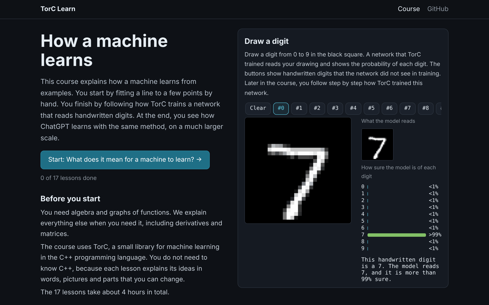
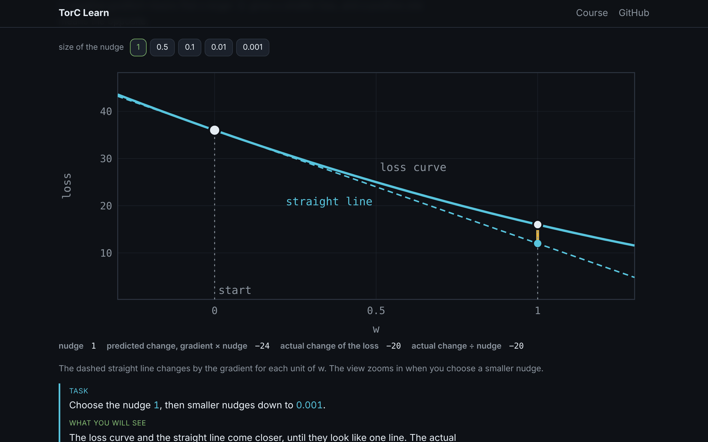
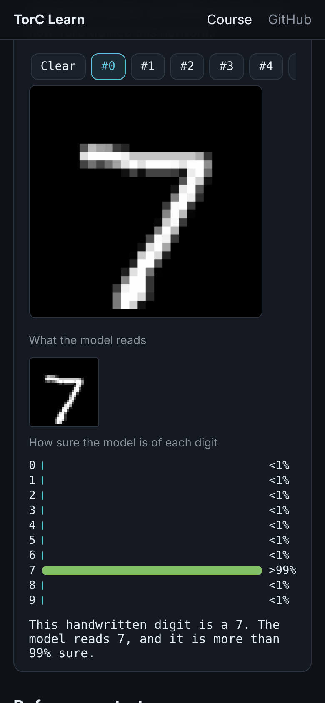

# TorC Learn

TorC Learn is a free online course about how a machine learns from examples. You start by fitting a line to a few points by
hand. You finish with a network that reads handwritten digits, and a look at how ChatGPT learns with the same method.

The course is for a high-school graduate who knows no machine learning yet. You need algebra and graphs of functions. The lessons
explain everything else, including derivatives and matrices. You do not need to read C++.

**The course is online at https://ivorlipic.github.io/TorC/**

Every number about TorC on the site comes from a real run of [TorC](https://github.com/IvorLipic/TorC/tree/main), a small C++
library for tensors and automatic gradients. The tests check each of these numbers against that run.

## What it looks like

The home page shows the promise of the course and a live demo. You draw a digit, and a network that TorC trained reads it.



Each lesson has parts that you can change, with a task and the result to look for. Here, the lesson "The gradient" lets you
choose the size of a nudge and compare the loss curve with a straight line.



The site also works on a phone. This picture shows the digit pad at a width of 390 pixels.



## The course at a glance

The main path has 17 lessons in 6 parts, about 4 hours in total. The appendix "Using TorC" is for readers who want to write
TorC code. The Backprop lab is a free playground. Neither is part of the lesson order.

| Part | Lessons | Minutes |
|---|---|---|
| 1. What it means to learn | 1. [What does it mean for a machine to learn?](https://ivorlipic.github.io/TorC/lessons/what-is-learning/) | 14 |
| 2. The gradient and gradient descent | 2. [The gradient](https://ivorlipic.github.io/TorC/lessons/why-gradients/)<br>3. [Gradient descent with many parameters](https://ivorlipic.github.io/TorC/lessons/sgd-step/) | 28 |
| 3. Neural networks | 4. [The neuron and the layer](https://ivorlipic.github.io/TorC/lessons/linear-layer/)<br>5. [Activation functions](https://ivorlipic.github.io/TorC/lessons/nonlinearity/)<br>6. [Two classes and the decision boundary](https://ivorlipic.github.io/TorC/lessons/classification/)<br>7. [Softmax and cross-entropy](https://ivorlipic.github.io/TorC/lessons/losses/)<br>8. [How the computer finds every gradient at once](https://ivorlipic.github.io/TorC/lessons/backprop/)<br>9. [Why deep networks are hard to start](https://ivorlipic.github.io/TorC/lessons/deep-nets/) | 87 |
| 4. Training in practice | 10. [The training loop](https://ivorlipic.github.io/TorC/lessons/training-loop/)<br>11. [Better optimizers](https://ivorlipic.github.io/TorC/lessons/optimizers/)<br>12. [Does it work on new data?](https://ivorlipic.github.io/TorC/lessons/generalization/) | 45 |
| 5. Reading handwritten digits | 13. [Reading handwritten digits with a network](https://ivorlipic.github.io/TorC/lessons/mnist-mlp/)<br>14. [One training step, followed end to end](https://ivorlipic.github.io/TorC/lessons/one-step/)<br>15. [Convolution](https://ivorlipic.github.io/TorC/lessons/convolution/)<br>16. [Reading digits with a convolutional network](https://ivorlipic.github.io/TorC/lessons/mnist-cnn/) | 62 |
| 6. Where this goes next | 17. [From digits to ChatGPT](https://ivorlipic.github.io/TorC/lessons/from-digits-to-chatgpt/) | 10 |
| Using TorC (appendix) | [Tensors](https://ivorlipic.github.io/TorC/lessons/tensors/)<br>[Modules](https://ivorlipic.github.io/TorC/lessons/modules/)<br>[Common errors in TorC programs](https://ivorlipic.github.io/TorC/lessons/torc-pitfalls/)<br>[The symbols of this course](https://ivorlipic.github.io/TorC/lessons/notation/)<br>[Glossary](https://ivorlipic.github.io/TorC/lessons/glossary/) | 54 |
| Labs | [Backprop lab](https://ivorlipic.github.io/TorC/lessons/backprop-lab/) | 7 |

This table comes from [`site/course.json`](site/course.json), the file that the home page reads.

## Run the site on your computer

You need Node.js 20 or later and Python 3. Run these commands from the root of a checkout of the branch `web`. The site has no
build step. These commands serve it under `/TorC/`, as GitHub Pages does.

```bash
mkdir -p build/srv && ln -sfn ../../site build/srv/TorC
python3 -m http.server -d build/srv 8000
```

Then open http://localhost:8000/TorC/ in a browser. The folder `build/` is not tracked by git.

## Checks for contributors

Run these commands from the root of the checkout. GitHub Actions runs the same checks on each push to `web` and on each pull
request that changes `site/`, `tools/` or the writing skill (see [`.github/workflows/`](.github/workflows/)).

| Command | What it checks |
|---|---|
| `node --test site/test/*.test.mjs` | The JavaScript port against the real TorC output, the lesson rules, LaTeX and the site tools |
| `node tools/check_site.mjs` | `course.json`, the lesson pages and modules, the trace files, relative URLs and assets |
| `tools/prose/check.sh` | The writing rules on every visible sentence (0 hard findings allowed) |
| `tools/trace/run.sh --check` | The data in `site/data/` equals a fresh run of the pinned TorC |
| `node tools/snippets/check.mjs` | The TorC code on the home page compiles and runs against the pinned TorC |

The last two commands need clang 18 and CMake 3.24 or later. With GCC 14, set `CXX=g++-14` for the trace check and add
`--cxx g++-14` to the snippet check. The trace check downloads TorC and the MNIST digits
into `build/`.
The trace check takes about 6 minutes. Run the snippet check after the trace check, because it uses the TorC source that the
trace check downloads. To write new data after a change to a trace program, run `tools/trace/run.sh` without `--check`.

Before you change a lesson, read [`CLAUDE.md`](CLAUDE.md) and [`docs/authoring.md`](docs/authoring.md). They give the rules for
numbers, writing and reviews. A number about TorC on a lesson page comes from a trace, and nobody types it by hand.

## The parts of the repository

The repository has two independent branches. Do not merge one into the other.

| Branch | What it holds |
|---|---|
| `main` | [The TorC library](https://github.com/IvorLipic/TorC/tree/main), with its C++ source, tests and examples |
| `web` | This course, with the site, the tools that run TorC, and the project documents. It holds no library source |

Other branches are short-lived work branches. For example, `claude/trusting-archimedes-kjzrto` held the course rework until it
merged into `web` on 2026-11-08.

The branch `web` uses TorC at one fixed commit, which [`tools/trace/TORC_REF`](tools/trace/TORC_REF) names. A change to the
library goes to `main` first. Then `TORC_REF` moves to the new commit.

| Folder | What it holds |
|---|---|
| [`site/`](site/) | The static website. GitHub Pages serves it as it is ([`pages.yml`](.github/workflows/pages.yml), from `web` only) |
| [`site/data/`](site/data/) | The JSON files that the trace programs write. Do not edit them by hand |
| [`site/test/`](site/test/) | The Node tests |
| [`tools/trace/`](tools/trace/) | The C++ programs that run the real TorC and write `site/data/` |
| [`tools/prose/`](tools/prose/), [`tools/snippets/`](tools/snippets/) | The writing check and the home-page code check |
| [`docs/`](docs/) | The project documents (see below) |
| [`.claude/`](.claude/) | The review agents and the vendored writing skill that contributors use |

Where to read more:

- [`docs/architecture.md`](docs/architecture.md) tells how the data flows from TorC to the page, and the site layout.
- [`docs/content-plan.md`](docs/content-plan.md) gives the curriculum and the reasons for its order.
- [`docs/authoring.md`](docs/authoring.md) tells how to add a lesson, a trace scene or an operation.
- [`docs/trace-schema.md`](docs/trace-schema.md) describes each JSON file in `site/data/`.
- [`docs/decisions.md`](docs/decisions.md) records the decisions of the project.
- [`ROADMAP.md`](ROADMAP.md) shows the status and the open work.

## License

MIT. See [`LICENSE`](LICENSE).
